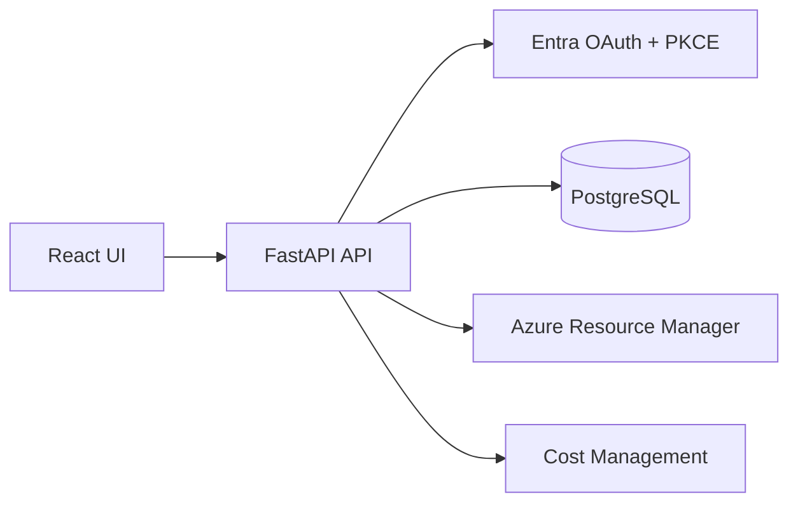

# Architecture

OAuth state is stored as a hash in PostgreSQL, expires after ten minutes, is consumed before exchange, and is bound to an HttpOnly SameSite cookie. The code exchange is server-side with PKCE. The token response is Fernet-encrypted before persistence; the key is external configuration. Expired access tokens are refreshed server-side when possible. ARM clients use backend-only bearer tokens, timeouts, pagination, and safe error mapping. Connections and subscriptions are scoped to a platform user. The development header identity must be replaced before production.

## SOLID boundaries

- Routes handle HTTP validation, cookies, status codes, and response envelopes.
- `OAuthService` owns OAuth state, PKCE, code redemption, and renewal; `token_crypto.py` owns encryption.
- `AzureClient` owns Azure HTTP transport, ARM pagination, timeouts, and provider error normalization.
- `db/models.py` owns persistence schema and relationships; migrations own schema evolution.
- `providers/contracts.py` defines small subscription, resource, and cost protocols so application code can use test doubles without depending on HTTP details.
- `manual.py` is an isolated development-only in-memory token adapter and never participates in normal OAuth persistence.
- `frontend/src/api.ts` owns browser networking and typed response errors; React components own rendering and interaction.

The receiving platform supplies the verified user identity through the `platform_user()` dependency in `app/api/routes.py`. Azure provider credentials remain an infrastructure concern and are never moved into frontend configuration.
