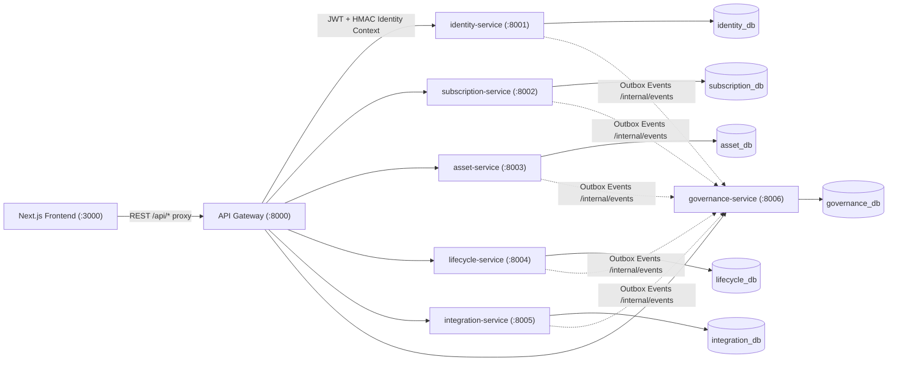

# UniSora Architecture Overview

UniSora has been refactored from a single-process FastAPI + SQLAlchemy monolith into a **modular, loosely coupled microservices architecture** with strict per-service data ownership, Clean Architecture layering, SOLID abstractions, and an API Gateway entrypoint.

## System Topology

## Architectural Principles

1. **Domain-Driven Service Boundaries**
   Each microservice owns one cohesive bounded context:
   - `identity-service`: authentication, organizations, onboarding orchestration, departments, employees.
   - `subscription-service`: SaaS contracts, license pools, user assignments, manual spend entries, CSV import.
   - `asset-service`: IT hardware inventory, employee assignments, maintenance tickets, CSV import.
   - `lifecycle-service`: onboarding/offboarding workflows and extensible completion verification strategies.
   - `integration-service`: external SaaS/cloud connectors (AWS, Azure, OpenAI, Anthropic, Gemini, and generic SaaS providers via a registry).
   - `governance-service`: alerts, audit logs, portfolio analytics, CSV audit exports, idempotent event consumer.

2. **Clean Architecture Inside Every Service**
   Every service separates responsibilities across four layers:
   - `app/domain/`: pure domain logic, entities/enums, calculation rules, strategy interfaces (`Protocol` / ABCs) without framework imports.
   - `app/application/`: use-case orchestration depending only on repository/client/publisher abstractions (Dependency Inversion).
   - `app/infrastructure/`: SQLAlchemy models, repository implementations, HTTP service clients, external provider SDK adapters, outbox publisher.
   - `app/api/`: FastAPI routers, Pydantic DTOs, request validation, HTTP exception translation.

3. **Zero Cross-Service Database Coupling**
   Services never share ORM models or query another service's tables. Cross-service interactions happen over explicit internal REST APIs (authenticated via signed HMAC `X-Internal-Service-Token` headers) or durable transactional outbox events delivered to `governance-service`.

4. **Shared Cross-Cutting Kit Without Domain Coupling**
   `packages/service-kit` (`unisora_kit`) contains strictly non-domain infrastructure primitives: configuration base settings, structured JSON logging with correlation IDs (`X-Request-ID`), standard error envelope handlers, JWT/internal-HMAC auth dependencies, health check helpers, event envelope + outbox dispatcher, and resilient HTTP client helpers.
